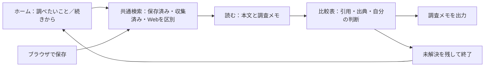

# my-search：UX全体の競合比較、差別化、機能案

> **再監査による訂正（2026-10-26）**：[必要性再監査](differentiation-necessity-audit-2026-10-26-ja.md)を優先する。NotebookLM系、Obsidian Workspaces/Bases等の重複を追加確認し、本書のF2＋F3をP0の中心とする優先提案は撤回した。以下の機能案・P0/P1表記は初回提案の履歴として残す。本人が今回示した用途順位は「収集・選別→比較・調査メモ→再発見」。これは市場の人数順位を意味しない。

2026-10-26。前提は「検索機能だけでなく、使い始めてから調べ物を終え、後日再開するまで」を比較すること。本書は製品提案であり、承認済み要件・実装完了報告ではない。

## 結論

推奨する方向は、**日本語のWeb記事とPDFを使った調べ物を、収集→読む→比較→根拠を残す→再開→成果物に渡すまでつなぐ、個人向けの調査作業環境**。

「全文検索」「意味検索」「ローカル保存」「引用付きメモ」は、それぞれ既存製品にある。単機能を独自性として訴求する根拠は弱い。差別化の候補は、**一つの調査目的を持ち続け、記事・引用・自分の判断・未解決事項を行き来する負担を減らす体験全体**に置く。

既存機能からこの方向に近いのはmy-searchの強みだが、現状で競合より優れていると実証したわけではない。対抗案は「Raindropで保存」「Readwiseで読む」「Obsidianでまとめる」「Zoteroで引用する」といった単体・組み合わせの両方。

## 調査方法と証拠の強さ

- my-search：現行の `public/index.html`、検索・リーダー・メモ表のJS、根拠照合サービス、出力サービス、導入手順を確認。既存スクリーンショットも確認したが、古い名称があり現在画面の証拠には使わない。
- 競合：公式ヘルプの操作手順・画面例・提供範囲を確認。競合アカウントでの同条件の作業実測、購入、インストールはしていない。
- my-searchの隔離デモはメモリDBで起動ログを得たが、調査用ブラウザからlocalhostへ接続できず、今回の最新画面での操作検証は未完了。以下の摩擦は静的な導線レビューからの仮説であり、実測クリック数・所要時間・利用者の感想ではない。
- 機能が資料に見当たらない場合は「未確認」とする。競合に不可能と断定しない。各製品のプラグイン・拡張・有料プランによって体験は変わる。

比較シナリオ：日本語で技術選定メモを書く人が、Web記事とPDFを集め、候補を比べ、根拠を残し、翌週に作業を再開してメモを書き上げる。

## 比較する製品の役割

| 製品 | 代表的な使い方 | 比較に含める理由 |
|---|---|---|
| Raindrop.io | ブラウザから保存し、コレクション・検索で再利用 | 保存と再発見の直接競合 |
| Readwise Reader | 複数形式の情報を集め、読み、注釈をノートへ渡す | 読む・学ぶ流れの直接競合 |
| Karakeep | 自分のサーバー等で情報を保存・整理・検索する | 自己管理・AI補助・収集の直接競合 |
| Obsidian＋公式Web Clipper | Web情報をローカルノートへ取り込み、自分の知識と統合 | ローカル知識管理と成果物作成の代替 |
| Zotero | 資料を管理し、PDF注釈から引用・執筆へ進む | 調査・根拠・引用の重要な隣接競合 |
| Inoreader | 情報源を継続購読し、ルールで新着を選別する | 自動収集・新規発見の代替 |

## UX全体の比較

表中の「強い」は公式の導線・提供範囲から見た用途適合の判断であり、同条件の操作試験による順位ではない。

### 製品ごとの一連の体験

以下の「完結の仕方」は、公式機能を比較シナリオへ当てはめた分析であり、各社の製品コンセプトを断定したものではない。

| 製品 | 入口から成果までの流れ | 中心となる単位 | my-searchと比べた全体の違い |
|---|---|---|---|
| my-search現状 | ローカル起動→サイト登録またはURL/PDF取込→検索・候補選別→本文とメモ→引用・表→カード保存→後日検索→コピー/出力 | 記事・カード・検索条件 | 収集から読む・根拠を残すまで部品がそろう。調査をまたぐ比較・再開と、導入・保全の分かりやすさが不足候補 |
| Raindrop | アカウントと拡張機能→閲覧中に保存→コレクション/タグ→検索・絞り込み→保存ページ・ハイライト→コピー・共有・出力 | ブックマークとコレクション | 日常の保存から再検索へ入る導線が明確。my-searchは保存の手軽さで追い付く必要がある。比較・結論は他のノートを併用する構成も代替として比較 |
| Reader | アカウントと取り込み導線→記事/PDF/Feed→Inbox等で読む順序を管理→読書・注釈→Library検索→Readwise/外部ノートへ渡す | 読む文書と注釈 | 読む量が多い人の継続習慣を支える。my-searchは読書機能の幅で競うより、読む目的と資料横断の判断を一つの作業へまとめる候補 |
| Karakeep | Cloudまたは自己ホストを選ぶ→拡張機能/モバイル/RSS→本文・タグ・保存コピー→リスト整理→全文/意味検索→資料を再利用 | 保存物とリスト | 自己管理、AI、自動収集、検索の組み合わせが近い競合。my-searchのローカル・AIという説明だけでは選ぶ理由にならない |
| Obsidian＋Clipper | アプリと保管庫を用意→Clipperの取り込み先/テンプレート→Webをノート化→注釈・リンク・検索→調査ノートへ統合→Markdownのまま執筆・持ち出し | ノートとリンク | データがそのまま成果物につながる。my-searchは自由度や拡張性より、構成を作らず調査を始めて引用表へ進めることを狙う。Obsidianに慣れた人には乗り換え理由が弱い可能性 |
| Zotero | デスクトップと資料収集→書誌/添付管理→PDFで注釈→引用をノートへ集約→元ページで確認→ワープロ等で引用・執筆 | 文献と注釈・ノート | 根拠から執筆までの往復を既に持つ。my-searchはWeb技術記事とPDFの比較調査を簡単にできるかで勝負し、学術引用機能の代替を主張しない |
| Inoreader | アカウント→情報源/監視登録→ルール/フィルター→新着確認→読む・注釈→検索/保存/外部への受け渡し | 情報源と記事・条件 | 継続的に流れる情報を選別する体験が中心。my-searchは特定の調査を終えるまでの根拠蓄積を中心に置く候補 |

中心となる単位が異なるため、単に機能の有無を足して総合点を付けない。同じ人の同じ作業に当てはめ、セットアップ・確認・中断・再開・出力まで含めて比較する。

### 使い始める・取り込む・読み進める

| 段階 | my-searchの現在 | 競合側の体験・強み | 差と設計判断 |
|---|---|---|---|
| 1. 導入 | Node/npmまたはDockerからローカル起動。APIキーなしでコアを使える | Raindrop/Reader/Inoreaderはアカウント型。Obsidian/Zoteroはインストール型。Karakeepはセルフホストに加えCloud提供の案内もある | ローカルはプライバシー上の選択肢だが、導入の手間は残る。起動・更新・保存場所まで製品として提供する必要 |
| 2. 初回価値 | 試用データあり。通常画面はカード一覧から始まり、「候補レビュー」「グルーピング」「Zettelkasten」「探す」が並ぶ | Raindropはまず保存、Readerはまず読むという中心作業が明確。Obsidianはノート作成から始められる | 機能の名前から使い方を推測させている。最初の目的を「調べたいこと」か「記事を残す」に絞る |
| 3. 閲覧中の保存 | アプリを開きURLを取り込み、本文とメモを保存。PDFも開ける | Raindrop/Reader/Karakeep/Obsidian Clipperにはブラウザでの取り込み導線がある。Zoteroには資料収集の導線がある | 保存動作の文脈切り替えで不利。拡張機能は独自性ではなく、乗り換えを妨げないための基本機能 |
| 4. 継続収集 | サイト登録、取得範囲プレビュー、RSS等の収集、検索条件保存・新着件数 | Inoreaderは監視・ルール・フィルターが中心。KarakeepもRSS収集あり。ReaderもFeedを持つ | 自動収集だけでは差別化が弱い。「いまの調査の不足を埋める新着」へ結び付ける。取得対象と本文取得範囲を明示 |
| 5. 候補の選別 | 未確認・保留・保存・見送りを管理。検索から読んで次へ進める | ReaderはInbox/Later/Archive等、Inoreaderはフィードと選別の流れを持つ | 状態管理は同等性のために必要。ただし「カード」「候補」「記事」の違いを初回に覚えさせない |
| 6. 読む | 本文とメモを左右に配置。PDFページ、翻訳表示、下書き復元の経路あり | Readerは複数形式の読書・注釈が中心。ZoteroはPDFとノートが密接。Obsidian ClipperにもReader表示あり | 二画面だけでは独自性にならない。調査目的と採用した根拠をリーダー内で常に確認できることを強化 |

### 整理・探す・使う・続ける・離れる

| 段階 | my-searchの現在 | 競合側の体験・強み | 差と設計判断 |
|---|---|---|---|
| 7. 注釈・メモ | 選択引用、出典付きコピー、引用元ジャンプ、表メモ、根拠候補の本文照合 | Readerは注釈とノート出力。Zoteroは引用とPDF元ページへのリンク。Obsidianは自由なノート構成 | 引用そのものは既存。引用と自分の判断を分け、複数記事から比較表を作る導線が候補 |
| 8. 整理 | タグ、リンク、KJグループ、グラフ、アーカイブ | Raindropはコレクション、Karakeepはリスト・自動タグ、Obsidianはリンクとノート、Zoteroは資料管理 | 整理方式を増やすより、調査中に集まったものが目的別に自然に残る構造を優先。既存整理機能を削除する提案ではない |
| 9. 検索 | カード一覧検索と「探す」が別入口。「探す」は収集記事・カード・Webを選択。抜粋や対象範囲を表示 | Raindropは一つの検索欄で属性・本文・意味検索と絞り込み。Karakeepも全文・意味検索。Obsidianは演算子検索。ReaderはLibrary検索が中心 | 「意味で探す」だけでは差がない。入口を統一し、保存済み・収集済み・Webの境界を結果で示す |
| 10. 検索の失敗 | 対象0件、未収集、本文なしなどを区別する既存改善あり | Raindropは索引待ち・保存コピー有無の説明あり。ReaderではFeedが全文検索対象外という境界がある | my-searchは収集済みを保存前でも検索できる設計を活かせる。ただし全文取得のない資料を全文検索済みと誤解させない |
| 11. 根拠の再利用 | 記事単位のメモ・引用・表からコピーやMarkdown出力へ進める | Readerは注釈を他ノートへ連携。Zoteroは引用・文献管理から執筆へ。Obsidianは成果物自体をノートで作れる | 記事ごとのメモを横断し、「この調査の結論・根拠・留保」を一つに出すところが追加候補 |
| 12. 後日の再開 | 検索条件の保存、状態管理、リーダー下書きはある。調査目的・未解決・比較表をまとめた再開単位は今回の確認範囲では未確認 | Readerは保存ビュー、Obsidianはノート構成、Zoteroは資料とノートで文脈を保持できる | 競合で不可能とは言えない。利用者が構成を作らず「前回の調査の続き」に戻れる既定体験を作る |
| 13. 複数端末・持ち運び | 単一ユーザーのPCローカル中心。製品としての同期は未提供 | Reader/Raindrop/Inoreader/Karakeepにモバイル導線がある | 一般層向けには大きな差。まずPCで調査を完結する層に絞り、モバイル保存の必要性を別途確認 |
| 14. 障害・保全・退出 | SQLite、バックアップ/復元スクリプト、Markdown等の出力。ブラウザ内下書きとDB保存は別 | Raindropは出力・バックアップ、Readerは本文や注釈の出力、Obsidianはローカルファイル | 「ローカルだから安心」で終えず、何が保存済みで何を復元できるか画面で分かる必要。出力だけを独自性にしない |

### 現時点で勝負を避ける領域

- 一般的なブックマーク管理だけなら、ブラウザ保存と端末間利用の導線を持つ製品が有力。
- 読書・音声・多数のコンテンツ形式の幅ならReader等が有力。
- 高度な新着監視だけならInoreaderが有力。
- 論文の引用スタイルやワープロ連携が中心ならZoteroが有力。
- ノート環境の拡張性・既存エコシステムが重要ならObsidianが有力。

my-searchは全領域で同時に勝つ必要はない。「調査目的を維持したまま、Web記事とPDFの根拠を比較し、日をまたいで再開する」用途で、道具の組み合わせや設定の手間を減らせるかを検証する。

## 現状のUXで大きな問題候補

1. **一連の作業がデータ形式ごとの画面に分かれる。** カード一覧、候補、グラフ、探すという区分は実装構造には合うが、利用者の「何を調べ、何が分かったか」とは異なる。
2. **検索入口と目的が二つある。** 保存済みを探し直すのか、新規記事を発見するのかを理解して移動する必要がある。一方、全部を混ぜて順位だけ付けると、保存物と未確認記事の区別が消える。
3. **リーダー内の既存の強みが入口から見えにくい。** 引用元ジャンプ、出典付きコピー、表メモ、本文照合を知らないと、よくあるカードアプリに見えやすい。
4. **保存の単位が記事中心。** 記事をまたいだ目的、比較軸、暫定結論、未解決を保持する作業単位が弱い。検索条件保存と下書き復元は、調査の再開全体の代わりにはならない。
5. **利用者向けの運用体験が不足する。** npm起動、モデル準備、収集範囲、ブラウザ下書き、DBバックアップの違いを利用者が理解する必要がある。

これらは実利用観察前の仮説。評価記録の同意UI等も通常作業と並んでいるため、研究参加の管理は独立した任意の設定にまとめる案を検討する。ただし既存の同意内容や撤回手段を弱めない。

## 差別化の柱

| 柱 | 利用者の得るもの | 既存機能から使える部分 | 主張できる条件 |
|---|---|---|---|
| 目的から始めて、目的に戻る | 複数記事を読んでも「何を決めたいか」を見失わない | 自然文検索、読む目的、条件保存 | 目的の入れ直しと作業再開時間が減る |
| 根拠と判断を並べる | 原文、引用、自分の解釈を分けて比較できる | 本文照合、引用元、表メモ | 出典確認の負担を減らし、誤った根拠付けを増やさない |
| 集めたものも、保存したものも見失わない | 未保存記事と自分の知識を探し分けられる | 収集検索、カード検索、ソース別範囲 | 本文なし・取得失敗を含め検索範囲を理解できる |
| 手元に残して、そのまま続ける | 翌週・別環境でも作業と根拠を取り戻せる | SQLite、保存コピー、出力、下書き | 復元後に本文・引用位置・調査状態が戻る |

本文照合が証明するのは「引用文が保存本文に存在すること」。出典の正しさ、著者の主張の真偽、引用が結論を支持するかまで自動保証しない。画面の「確認済み」表記もこの範囲に限定する。

## 機能案：比較から導いた開発候補

### F1：調べ物のホームと共通の検索入口（P0・既存導線の再編）

起動時に「調べたいこと」と「続きから」を置く。検索欄を共通化し、結果を「保存した資料」「収集した資料」「Web」に分ける。保存済みを既定にするか、前回の目的を復元するかは対象層の試用で決める。Web検索は明示選択のままとし、ローカルの0件から自動送信しない。

検索語を変えても絞り込み・検索対象・現在の調査目的を保持。「自分の保存物だけ」は一操作で選択。既存のカード一覧は資料庫として残し、グラフ等は整理メニューへ置く案。

受け入れ条件：同じ入力・対象・条件が検索入口で一致する。保存物と未確認資料を見分けられる。0件・未取得・索引準備中が異なる。画面遷移後に検索語と位置が戻る。キーボード操作・日本語IMEで誤実行しない。

競合比較の理由：Raindropの一つの検索入口を基本水準として参考にし、my-search独自の複数コーパスの境界を見える形で加える。

### F2：調査ごとの作業スペース（P0・新規の中心機能）

「SQLiteの同時書き込みをどう扱うか」のように調査を作る。各調査に目的、資料の参照、検索条件、比較表、暫定結論、未解決を保存する。タグ付け・グラフ設計を開始条件にしない。目的入力は任意で、素早い保存を妨げない。

資料を複数の調査から参照でき、本文を調査ごとに複製しない。候補のレビュー状態は既存では全検索共通なので、「その調査で読んだ/採用した」を新しい調査内の状態として分ける。資料削除・アーカイブを調査削除に連動させない。

受け入れ条件：再起動後に目的・採用資料・未解決が戻る。同じ資料を二つの調査で使える。調査削除で資料本体を失わない。検索条件の更新と既存の検索保存を混同しない。

競合比較の理由：Obsidian等でも作れる構造を、利用者がテンプレートやプラグインを組まずに使える既定体験として提供する。

### F3：複数資料の比較表と引用への往復（P0・既存表メモの拡張）

調査の比較表へ、記事やPDFをまたいで引用を追加する。初期の列は「比較項目／引用／出典と位置／自分の判断／未確認事項」。本文横で引用を選ぶと行を追加し、行の出典から保存本文の該当箇所に戻れる。

引用は保存版に結び付ける。本文再取得時は古い引用を書き換えず、更新版との差を別扱いにする。ページ番号は推定か確認済みかを区別し、原文・自分の訳・要約も区別する。AIが候補を出しても人が採用する。

受け入れ条件：二記事と一PDFの根拠を同じ表に置ける。引用元へ戻れる。欠けた本文に架空の引用を追加しない。本文にあることと主張を支持することを別に表示する。削除・並べ替え・保存失敗で行を失わない。

競合比較の理由：Zoteroにも複数資料の注釈集約はある。Web記事とPDFの技術調査について、比較軸と自分の判断まで含む一連の導線を検証する。引用表だけで独自性を主張しない。

### F4：前回の調べ物に戻る（P1・F2とF3に依存）

ホームに調査名、最後に読んだ資料、未解決の一行を出す。「続きから」で目的・検索条件・比較表・読書位置を復元。本文やメモの保存完了と、ブラウザ内だけの下書きを区別する。

受け入れ条件：ブラウザを閉じ、サーバーを再起動しても採用資料と比較表は戻る。資料が消えた場合は欠落と表示。別ブラウザでは利用できない一時下書きをDB保存済みとして表示しない。

競合比較の理由：競合の保存ビュー・ノート・資料コレクションでも文脈は残る。既定で目的と未解決まで提示して再開時間を短くできるかが価値。

### F5：調査メモとして出力（P1・F3に依存）

調査単位で目的、暫定結論、比較表、引用と位置、参考URL、残る疑問をMarkdownへ出力。通常の資料の一括Markdown出力とは分ける。Obsidianや普段のエディターに渡して完成させられるようにする。

受け入れ条件：原文引用と自分の記述を区別したまま出力。参照切れを明示。外部へ自動投稿しない。アプリを持たない人でも出典を確認できる範囲を示す。出力を完全バックアップと呼ばない。

競合比較の理由：Readerの外部ノート連携、Zoteroの執筆導線は強い。独自エディターを一から拡大するより、調査から成果物への境界を短くする。

### F6：ブラウザから素早く残す（P1・基礎機能）

閲覧中のページURLと任意の保存理由を、選択中の調査または未整理へ送る。タグや調査名の必須入力を避ける。「保存済み」「本文取得中」「本文なし」「検索可能」を区別。取得失敗時もURLと理由を残して再試行できる。

受け入れ条件：同じURLを再保存してもメモを上書きしない。アプリ停止時に未保存を伝える。無制限の外部サイトからローカルAPIへ書き込める構成を作らず、接続先と認証範囲を設計する。

競合比較の理由：Raindrop等に既にある基本導線。これ自体を差別化機能とは呼ばないが、調査スペースまで到達する摩擦を減らすために必要。

### F7：導入と保全を画面から完了する（P0は導入案の検証、実装範囲は別途決定）

起動アプリ／インストーラー候補を比較し、起動後に保存先・バックアップ状況・通常機能が使える状態を示す。初回に見本から検索→引用→出力まで試せるようにする。復元は内容を検査し、現在データの退避と件数確認を挟む。

受け入れ条件：通常利用でnpm・モデル設定・APIキーを必須にしない。更新前後と復元後に本文・メモ・引用・調査が保たれる。ブラウザ下書きがバックアップ対象か分かる。インストーラーがあるだけで更新・復元が完成したと扱わない。

競合比較の理由：ローカル志向の利点を、利用者による運用負担で相殺しないため。既存スクリプトがあることと、一般利用者が回復できることは異なる。

### F8：調査に関係する新着を確認（P2・継続収集の用途が確認できた場合）

保存検索の新着を調査へ結び付ける。自動で読了・採用・結論更新せず、利用者が選ぶ。通知は任意とし、「読まなければならない記事」を増やさない。

受け入れ条件：前回の確認以降の新着と古い未読を区別。取得範囲と重複を説明。通知なしでも使える。

競合比較の理由：監視の機能数でInoreaderと競うより、調査の未解決に役立つかを測る。

## 提案する画面のつながり



画面案（未実装）：

```text
ホーム
  [何を調べたい？                                  ] [探す]
  続きから：SQLite同時書き込み／未解決：更新競合の扱い
  [記事を残す] [資料庫]                         [設定・保全]

調査：SQLite同時書き込み
  目的：個人アプリで採る方式を決める
  [保存した資料] [収集した資料] [Webを選んで探す]
  結果一覧                 本文                   調査メモ
  タイトル・一致箇所       該当段落               比較項目
  本文取得の状態           [引用を追加]           引用と出典
  保存済み／未確認                                 自分の判断
                                                 未解決
```

全端末で三列を固定しない。狭い画面では本文とメモを切り替え、フォーカスと位置を戻す。横スクロール・キーボード・読み上げを含めたレイアウト検証が必要。

## 開発順序と判断の分岐

1. **F1＋F7の初回導線を設計**：既存機能の再編で価値を伝え、検索→引用→出力の見本を作る。データモデルの大改造を開始条件にしない。
2. **F2＋F3を一つの縦の作業として実装候補化**：一つの調査でWeb記事とPDFを比較し、根拠付きのメモを残す。中心の差別化仮説を試せる最小単位。
3. **F4＋F5で作業を完結**：中断からの再開と成果物への受け渡しまで試す。F2・F3だけでUX全体の成功と判定しない。
4. **F6と既存データ移行を対象者の実際の保存経路に合わせて優先**：取得の手間で試用が止まる場合は、中心機能より先に改善する。
5. **F8は観察後**：新着監視の需要が弱ければ増やさない。

後順位：AIチャットの拡張、グラフの高度化、新しい分類方式、音声読書、多人数共同編集。機能の価値を否定するものではないが、今回の用途の差別化を直接検証しない。スマホ保存が必須の利用者にはF6だけでは不足するため、PC中心層を選ぶか同期まで範囲を広げるかを判断する。

## 差別化が成立するかの検証

同じ参加者に同じ作業を繰り返して学習効果を混ぜないよう、難度を合わせた別テーマで順序を入れ替える。競合に慣れた利用者と初見者を分け、製品の最適な公式導線を使う。my-searchだけに事前準備されたデータや完成した比較表を与えない。

| 課題 | 比較先 | 主に測るもの |
|---|---|---|
| 新規導入から最初の記事の保存・再検索 | Raindrop、Karakeep、Obsidian Clipper | セットアップ時間、支援回数、保存成功の理解 |
| Web記事2本とPDF1本を読み、根拠付き比較を作る | Reader＋普段のノート、Zotero、Obsidian | 完了時間、画面・アプリ往復、引用と出典の正確さ |
| 一週間後に続きを始め、未解決を一つ解決する | 上記で作ったノート・ビュー・資料管理 | 再開までの時間、目的の思い出し、引用元の確認 |
| タイトルを忘れた保存記事を探す | Raindrop、Karakeep、普段の手段 | 初回検索の成功、正解確認時間、検索し直し回数 |
| 必要な新着だけを調査に取り込む | Inoreader、Reader Feed | 有用記事へ到達する時間、不要記事の割合 |
| 他の環境へ持ち出し、資料とメモを確認する | 各製品の標準出力・復元 | 内容の欠落、位置情報・出典の保持、復元の支援回数 |

仮の採用基準：中心課題の「比較表の作成」と「後日の再開」で既存手段より中央値20%以上短縮し、出典の正確さが悪化しないこと。これは市場標準ではなく事前に置く提案値。小人数の結果を市場全体へ一般化しない。所要時間だけでなく、利用者ごとの成功・失敗と理由、継続して選ぶかを残す。

検索エンジンの一般性能は[既存の検索目標](search-goals-ja.md)に従い公開外部の人手由来評価で別途測る。製品UXを比べる観察はその代わりではなく、本人に一般検索性能用の質問作成を要求するものでもない。

F2・F3を試しても利用者が「既存のノートで十分」と判断するなら、調査環境の拡大を止め、再発見専用に集中する。保存時の手間や導入だけで離脱するなら、まず基本体験を直す。競合の弱点を仮定して開発を続けない。

## 根拠一覧

確認日はいずれも2026-10-26。以下は機能・導線の根拠で、競合との実測優劣の証拠ではない。

- Raindrop：[検索と意味検索・検索範囲・索引待ち](https://help.raindrop.io/using-search/)、[拡張機能とサイドバー](https://help.raindrop.io/install-extension)、[出力・バックアップ](https://help.raindrop.io/export)。
- Reader：[全文検索とFeedの境界・検索とフィルターの区別](https://docs.readwise.io/reader/docs/faqs/searching)、[保存ビュー](https://docs.readwise.io/reader/docs/faqs/filtered-views)、[注釈・本文の出力](https://docs.readwise.io/reader/docs/faqs/exporting)、[製品全体](https://readwise.io/read)。
- Karakeep：[公式機能一覧](https://docs.karakeep.com/)、[公式画面例](https://docs.karakeep.com/getting-started/screenshots/)、[Cloud提供の案内](https://karakeep.app/pricing/)。
- Obsidian：[公式Web Clipper](https://obsidian.md/help/web-clipper)、[取り込み](https://obsidian.md/help/web-clipper/capture)、[テンプレート](https://obsidian.md/help/web-clipper/templates)、[ノート検索](https://obsidian.md/help/plugins/search)。プラグインを無制限に組み合わせた場合の機能範囲は調査していない。
- Zotero：[PDF Readerとノート・引用への往復](https://www.zotero.org/support/pdf_reader)。
- Inoreader：[検索](https://www.inoreader.com/features/search)、[ルール](https://www.inoreader.com/features/rules)、[フィルター](https://www.inoreader.com/features/filters)、[注釈](https://www.inoreader.com/features/annotations)、[モバイルのオフライン](https://www.inoreader.com/features/offline-mode)。

my-searchの確認元：`public/index.html`、`public/js/search_screen_ui.js`、`public/js/cards_ui.js`、`public/js/reader_ui.js`、`public/js/memo_table.js`、`services/evidence_service.ts`、`services/markdown_export_service.ts`、`services/route_context.ts`、`docs/trial.md`、`docs/search-goals-ja.md`、`docs/saved-card-search-default-decision-2026-10-25-ja.md`、`package.json`。

## この調査で確定したもの・残るもの

UX全体の段階別比較、競合と重なる機能、現状の摩擦仮説、差別化の柱、8件の機能案、開発順序、比較試用の課題を整理した。実装や実利用上の優位性を確定したものではない。次の意思決定は、F2・F3の体験が対象者に選ばれるか、または再発見に集中すべきかを試用で確かめること。
